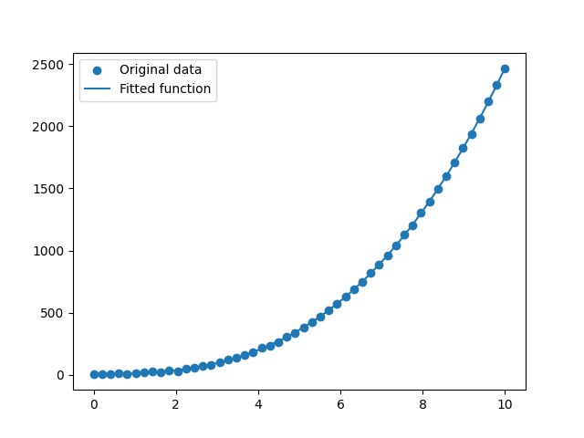

<div align="center">

# Sensors & Sensing

**Hands-on experiments in sensor data processing, signal analysis, and robot perception**

Coursework for **Sensors and Sensing, Spring 2023** · Innopolis University

[](https://www.python.org/)
[](https://jupyter.org/)
[](https://numpy.org/)
[](https://scipy.org/)
[](https://opencv.org/)

</div>

## About

This repository documents a practical journey from raw, noisy measurements to useful estimates and geometric features. Each assignment combines working Python code, visualizations, and concise explanations of the results.

The projects progress through five topics:

**Statistics & regression → State estimation → Frequency-domain processing → Line detection → Robust 3D perception**

<div align="center">
  
  <br>
  <sub>Polynomial regression fitted to noisy data · Homework 1</sub>
</div>

## Assignments

| # | Project | Topics & techniques | Open |
|---|---------|---------------------|------|
| **01** | **Statistics & Nonlinear Regression** | Central Limit Theorem, bimodal distributions, noisy data, polynomial curve fitting | [Report](Homework1/README.md) |
| **02** | **Recursive & Kalman Filtering** | 1D state estimation, process noise, filter tuning, GPS distance calculation, smartphone accelerometer data | [Notebook](Homework2/SensorsAndSensingHW2.ipynb) |
| **03** | **Signal Processing & Audio Denoising** | DCT, DFT/FFT, inverse transforms, signal smoothing, tonal noise removal | [Notebook](Homework3/SensorsAndSensingHW3.ipynb) |
| **04** | **Hough Transform & Map Analysis** | Image preprocessing, Canny edge detection, probabilistic Hough transform, line extraction from a floor map | [Notebook](Homework4/SensorsAndSensingHW4.ipynb) |
| **05** | **RANSAC & 3D Point Clouds** | Robust line fitting, outlier detection, plane segmentation, DBSCAN clustering, object distance estimation | [Notebook](Homework5/SensorsHW5.ipynb) |

## Tech Stack

- **Python & Jupyter** — reproducible experiments and documented results
- **NumPy & SciPy** — numerical computing, optimization, and spectral analysis
- **Matplotlib & pandas** — visualization and sensor-data analysis
- **OpenCV** — image processing and geometric feature extraction
- **Open3D** — 3D point-cloud processing and segmentation

## Getting Started

Clone the repository and create an isolated environment:

```bash
git clone https://github.com/ipipos56/SensorsAndSensingS23.git
cd SensorsAndSensingS23
python -m venv .venv
source .venv/bin/activate
python -m pip install jupyter numpy pandas matplotlib scipy opencv-python open3d
```

Open the notebooks:

```bash
jupyter notebook
```

Or run the standalone Homework 1 experiments directly:

```bash
python Homework1/task1.py  # Central Limit Theorem demonstration
python Homework1/task2.py  # Polynomial regression
```

> **Note:** Some notebooks were originally developed in Google Colab and use Colab-specific display helpers. Homework 3 and the point-cloud section of Homework 5 also expect external audio and `pointcloud.pcd` input files, respectively. The notebooks retain their original outputs where available, so the results can be explored without rerunning every cell.

## Repository Structure

```text
SensorsAndSensingS23/
├── Homework1/                 # Statistics, regression, plots, and written report
├── Homework2/                 # Recursive/Kalman filters and mobile sensor data
├── Homework3/                 # DCT/DFT experiments and audio denoising
├── Homework4/                 # Hough line detection and floor-map analysis
├── Homework5/                 # RANSAC and 3D point-cloud segmentation
└── README.md
```

## Author

**Artur Eremov** · Robotics student at Innopolis University

[GitHub](https://github.com/ipipos56) · [Repository](https://github.com/ipipos56/SensorsAndSensingS23)

---

<div align="center">
  <sub>Built to explore how mathematics turns sensor measurements into perception.</sub>
</div>
